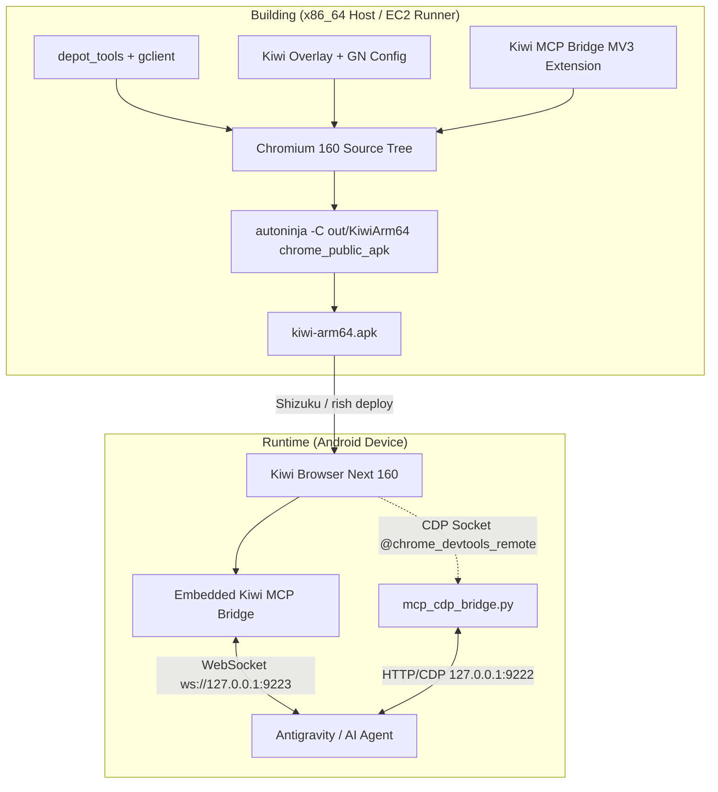

<p align="center">
  
</p>

<h1 align="center">Kiwi Browser Next &middot; MCP Edition</h1>

<p align="center">
  <b>Modernized Chromium 160 Core &bull; Native Model Context Protocol (MCP) Integration &bull; Desktop Extensions on Android</b>
</p>

<p align="center">
  <a href="https://github.com/djsusmith/src.next/actions">
    
  </a>
  <a href="https://github.com/djsusmith/src.next/blob/kiwi/CHROMIUM_VERSION">
    
  </a>
  <a href="https://github.com/djsusmith/src.next/tree/kiwi/extensions/kiwi_mcp_bridge">
    
  </a>
  <a href="https://github.com/djsusmith/src.next/blob/kiwi/LICENSE">
    
  </a>
</p>

---

## 🌟 What is Kiwi Browser Next?

**Kiwi Browser Next** resurrects the legendary Android browser that first brought desktop Chrome extensions to mobile devices. This fork upgrades the underlying engine to **Chromium 160 Dev (`160.0.8157.3`)** and embeds **Model Context Protocol (MCP)** tool capabilities directly into the mobile browsing experience.

### ⚡ Key Features

- 🚀 **Chromium 160 Dev Engine:** Upgraded modern Blink rendering engine, V8 performance improvements, and current security patches.
- 🤖 **Model Context Protocol (MCP) Bridge:** Built-in MV3 extension & socket bridge allowing AI coding agents (Antigravity, Claude, Cursor) to automate tabs, inspect DOM, evaluate JavaScript, and capture screenshots.
- 🧩 **Desktop Chrome Extensions:** Native Android support for Manifest V3 desktop extensions and developer sideloading.
- 📱 **Shizuku Elevated Deployment:** Streamlined installation, live remote debugging socket forwarding, and package management via ADB/Shizuku (`rish`).
- 🛠️ **Automated CI/CD Pipeline:** Fully reproducible GitHub Actions workflow using Google Chromium `depot_tools` for ARM64 Android (`chrome_public_apk`).

---

## 🏗️ Architecture



---

## 🧩 Built-in MCP Tools Integration

Kiwi Browser Next comes with a dedicated **Manifest V3 MCP Bridge** located at [`extensions/kiwi_mcp_bridge/`](extensions/kiwi_mcp_bridge/).

### Supported Agent Actions

| MCP Tool | Description |
| :--- | :--- |
| `list_tabs` | Query all open browser tabs, active states, URLs, and titles |
| `navigate` | Direct a tab (or active tab) to any URL |
| `eval_js` | Safely evaluate client-side JavaScript in page context |
| `capture_screenshot`| Capture high-resolution viewport PNGs of the active tab |

### Loading the Extension Manually
1. Open Kiwi Browser and navigate to `chrome://extensions`.
2. Toggle on **Developer mode** in the top right corner.
3. Tap **+(from .zip / .crx / user dir)** or **Load unpacked** and select the [`extensions/kiwi_mcp_bridge/`](extensions/kiwi_mcp_bridge/) folder.
4. The bridge will automatically connect to your local agent at `ws://127.0.0.1:9223`.

---

## 🚀 Building & Deployment

### Automated GitHub Actions Workflow
The repository includes a battle-tested GitHub Actions workflow at [`.github/workflows/build_apk.yml`](.github/workflows/build_apk.yml).

To trigger a build:
1. Connect a self-hosted `x86_64` Linux runner (e.g. AWS EC2 `m6i.4xlarge`, 64 GB RAM, 200 GB SSD).
2. Go to **Actions** &rarr; **Build Kiwi Browser APK (Chromium 160 Dev ARM64)**.
3. Click **Run workflow**. The resulting signed APK will be uploaded to artifacts.

### Installing with Shizuku (`rish`)
If you have Shizuku running on your Android device:

```bash
# Sideload the APK and launch immediately
bash scripts/deploy_shizuku.sh path/to/kiwi-arm64.apk

# Or cleanly remove existing version first
bash scripts/deploy_shizuku.sh --uninstall-previous path/to/kiwi-arm64.apk
```

---

## 📂 Project Structure

```text
├── .build/
│   └── chromium_159/args.gn        # GN compilation arguments (ARM64, extensions enabled)
├── .github/workflows/
│   └── build_apk.yml               # depot_tools Chromium 160 build workflow
├── extensions/
│   └── kiwi_mcp_bridge/            # Built-in MV3 MCP Tool bridge extension
├── scripts/
│   ├── audit_chromium_overlay.py   # Overlay directory auditor
│   ├── deploy_shizuku.sh           # Shizuku APK installer & launcher
│   └── mcp_cdp_bridge.py           # CDP abstract UNIX socket to TCP forwarder
├── tests/                          # Automated unit & integration tests
├── CHROMIUM_VERSION                # Upstream target version (160.0.8157.3)
└── KIWI_VERSION                    # Kiwi release version (160.0.8157.3)
```

---

## ⚖️ License & Acknowledgments

- Kiwi Browser code is licensed under the terms described in the [LICENSE](LICENSE) file.
- Chromium code is copyright The Chromium Authors and licensed under the BSD License.
- Originating work by Arnaud Granal and the Kiwi Browser community.
