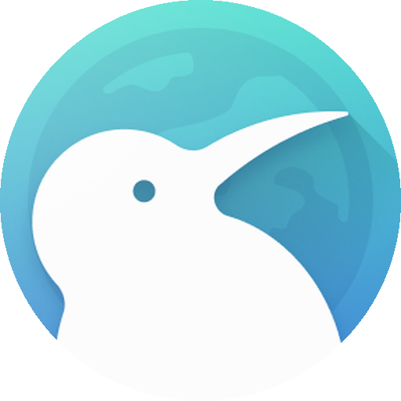
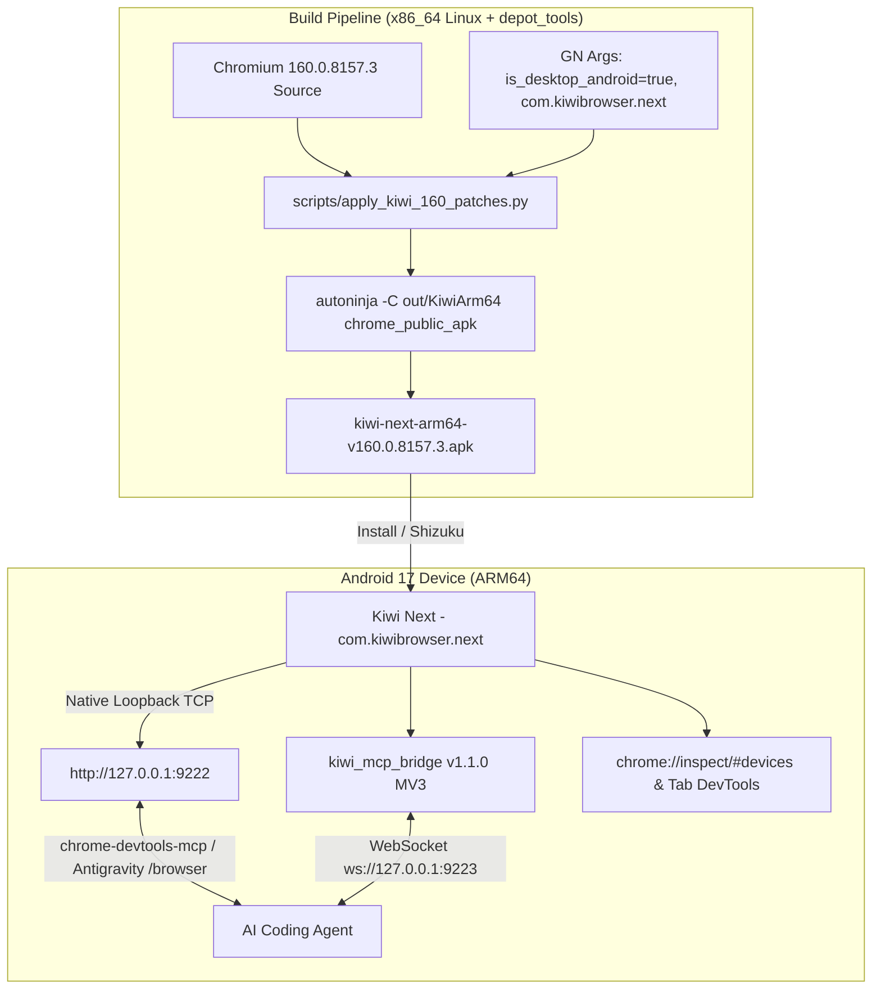

<p align="center">
  
</p>

<h1 align="center">Kiwi Next</h1>

<p align="center">
  <b>Authentic Kiwi Browser revived on Chromium 160 Dev (<code>160.0.8157.3</code>) &mdash; with desktop Manifest V3 extensions on smartphones, tab-native Developer Tools, on-device <code>chrome://inspect/#devices</code>, and direct loopback CDP / MCP integration for AI coding agents.</b>
</p>

<p align="center">
  <a href="https://djsusmith.github.io/kiwi-next/">
    
  </a>
  <a href="https://github.com/djsusmith/kiwi-next/releases/tag/v160.0.8157.3">
    
  </a>
  <a href="https://github.com/djsusmith/kiwi-next/blob/kiwi/CHROMIUM_VERSION">
    
  </a>
  <a href="https://github.com/djsusmith/kiwi-next/tree/kiwi/extensions/kiwi_mcp_bridge">
    
  </a>
</p>

---

## Overview

When [`kiwibrowser/src.next`](https://github.com/kiwibrowser/src.next) was archived on Chromium 105, Android power users and mobile web developers lost the browser that brought full desktop Chrome extensions, on-device DevTools, and open hacking workflows to phones.

**Kiwi Next** (`com.kiwibrowser.next`) is a clean, reproducible port of Kiwi's signature features onto **Chromium 160 Dev (`160.0.8157.3`)** targeting **Android 17 (API 37, `arm64-v8a`)**, physically built and verified on a **Samsung Galaxy S25 Ultra (`SM-S938B`)**.

Instead of relying on brittle legacy Chromium 105 patch dumps, every feature is maintained as an idempotent, unit-tested patcher in [`scripts/apply_kiwi_160_patches.py`](scripts/apply_kiwi_160_patches.py) (`11/11` passing tests in `tests/`).

---

## Verified Features (Tested on Device)

Every item listed below has been compiled into `kiwi-next-arm64-v160.0.8157.3.apk` and verified directly on Android 17 (`SM-S938B`):

### 1. Desktop Manifest V3 Extensions on Smartphones
- Compiled with `is_desktop_android = true` (which enables `enable_desktop_android_extensions = true`) plus phone-layout adaptations so desktop extensions work on smartphones, not just tablets.
- **Phone Toolbar Compatibility Fix:** Replaced upstream Chromium 160's tablet-only `(ToolbarTablet) mToolbarLayout` cast in `ToolbarManager.java` with `(ViewGroup) mToolbarLayout` and added `extensions_toolbar_container_stub` to `toolbar_phone.xml`, eliminating the smartphone startup `ClassCastException`.
- **Direct 3-Dot Menu Access:** Added **Extensions**, **Manage Extensions** (`chrome://extensions`), and **Chrome Web Store** directly into the phone overflow menu (`TabbedAppMenuPropertiesDelegate.java` and `AppMenuPropertiesDelegateImpl.java`), with a null-safe fallback to `chrome://extensions` in `ChromeTabbedActivity.java`.
- **WebUI Crash Fix:** Removed the `CHECK_IS_TEST()` abort in `chrome/browser/ui/webui/current_channel_logo.cc` so `chrome://extensions` and other Chromium WebUIs open cleanly on `android_channel = "dev"` without Google Chrome branding.

### 2. Full Developer Tools Opening as a Regular Browser Tab
- Flipped `kAndroidDevToolsFrontend` to `base::FEATURE_ENABLED_BY_DEFAULT` in `content/public/common/content_features.cc` and removed the `DeviceFormFactor.isNonMultiDisplayContextOnTablet()` guard in `DevToolsWindowAndroid.java`.
- **Tab-Native DevTools:** Patched `DevToolsWindow::Show()` in `chrome/browser/devtools/devtools_window.cc` so DevTools inserts its `WebContents` directly into `ChromeTabbedActivity`'s `TabModel` (`InsertWebContentsAt` + `ActivateTab`) right beside the inspected tab, rather than launching a stripped-down standalone `DevToolsActivity` CustomTab window.
- **Renderer Keep-Alive & Action Execution:** Sets `ChildProcessImportance::MODERATE` on the inspected tab so Android does not freeze the inspected page while viewing DevTools, and allows `DoAction(action)` to execute on load completion so `Inspect()`, `ShowConsolePanel()`, and `PauseInDebugger()` work reliably.
- **Always Available in Menu:** Tapping **⋮ → Dev tools** on any web page opens a DevTools tab inspecting that page; tapping it on a native page (such as the New Tab Page) opens `chrome://inspect/#devices` in a new tab.

### 3. On-Device `chrome://inspect/#devices`
- Enabled `//chrome/browser/resources/inspect:resources`, `inspect_resources.pak`, `devtools_targets_ui.cc`, `serialize_host_descriptions.cc`, and `//chrome/browser/ui/webui/inspect` on Android, and registered `InspectUIConfig` in `chrome_web_ui_configs.cc`.
- Patched `inspect.js` so `chrome://inspect/#devices` immediately displays **Kiwi Next (Local Device) `#LOCAL`** with all live open tabs, extension background pages, and service workers, complete with **`inspect`**, **`pause`**, **`focus tab`**, **`reload`**, **`close`**, **`inspect fallback`**, and **`Open tab with url`** (plus dedicated `#pages`, `#extensions`, `#service-workers`, `#workers`, `#other`, and `#remote-debugging` views).

### 4. Native Loopback CDP (`http://127.0.0.1:9222`) & Direct `chrome-devtools-mcp` Support
- On Android 17+, SELinux blocks apps and `u:r:shell:s0` from connecting to `@chrome_devtools_remote` abstract Unix sockets.
- Kiwi Next patches `chrome/browser/android/devtools_server.cc` to bind a native loopback `net::TCPServerSocket` directly on **`127.0.0.1:9222`** (with automatic `--remote-allow-origins=*` and fallback to ephemeral port / Unix domain socket).
- **Zero-Proxy AI Agent Control:** Connects directly to `chrome-devtools-mcp` and Antigravity's `/browser` subagent (`--browserUrl=http://127.0.0.1:9222`) with no root, no `socat`, and no ADB port forwarding. Verified live with `list_pages`, `take_snapshot`, and `evaluate_script`.

### 5. `kiwi_mcp_bridge` MV3 Extension (`v1.1.0`, `ws://127.0.0.1:9223`)
Located in [`extensions/kiwi_mcp_bridge/`](extensions/kiwi_mcp_bridge/), this Manifest V3 extension connects to a local WebSocket MCP server on `ws://127.0.0.1:9223` and exposes structured browser automation methods:

| Method | Underlying API | Verified Capability |
| :--- | :--- | :--- |
| `list_tabs` | `chrome.tabs.query` | Lists all open tabs, IDs, titles, URLs, and active status |
| `navigate` | `chrome.tabs.update` | Navigates the active or specified tab to any URL |
| `new_tab` / `close_tab` | `chrome.tabs.create` / `remove` | Opens or closes tabs programmatically |
| `eval_js` | `chrome.debugger` (`Runtime.evaluate`) | Evaluates JS in page context (bypasses strict page CSP) |
| `cdp_send` | `chrome.debugger.sendCommand` | Forwards raw CDP commands (verified with `DOM.getDocument`) |
| `capture_screenshot` | `chrome.tabs.captureVisibleTab` | Captures full PNG viewport screenshots as base64 data URLs |

### 6. AMOLED Dark Mode & Native Kiwi Branding
- Tuned Blink's dark mode foreground brightness threshold in `third_party/blink/renderer/platform/graphics/dark_mode_settings_builder.cc` from `150` to Kiwi's high-contrast AMOLED preset (`127`).
- Branded package as `com.kiwibrowser.next`, app label as **`Kiwi Next`**, and mapped the authentic white Kiwi adaptive icon layers (`ic_foreground.png` / `ic_background.png`) onto Chromium 160's `layered_app_icon.png` / `layered_app_icon_background.png` across all `mipmap-*` densities.

---

## Architecture & Patch Map



| Patch Function | Chromium 160 Target File(s) | Purpose |
| :--- | :--- | :--- |
| `patch_toolbar_phone` | `chrome/browser/ui/android/toolbar/java/res/layout/toolbar_phone.xml` | Adds `extensions_toolbar_container_stub` ViewStub to smartphone toolbar |
| `patch_toolbar_manager` | `chrome/android/java/src/org/chromium/chrome/browser/toolbar/ToolbarManager.java` | Fixes `ToolbarPhone` → `ToolbarTablet` `ClassCastException` with `(ViewGroup)` |
| `patch_app_menu_delegate_impl` | `.../app/appmenu/AppMenuPropertiesDelegateImpl.java` | Exposes `buildManageExtensionsItem()` & `buildChromeWebstoreItem()` on phones |
| `patch_tabbed_app_menu` | `.../tabbed_mode/TabbedAppMenuPropertiesDelegate.java` | Injects Extensions, Manage Extensions, Web Store & DevTools into phone ⋮ menu |
| `patch_chrome_tabbed_activity` | `.../ChromeTabbedActivity.java` | Null-safe fallback to `chrome://extensions` when toolbar coordinator is null |
| `patch_dark_mode_amoled` | `third_party/blink/renderer/platform/graphics/dark_mode_settings_builder.cc` | Sets AMOLED foreground brightness threshold to `127` |
| `patch_current_channel_logo` | `chrome/browser/ui/webui/current_channel_logo.cc` | Prevents `CHECK_IS_TEST()` `SIGABRT` on WebUIs for `android_channel = "dev"` |
| `patch_devtools_android` | `content/public/common/content_features.cc`, `DevToolsWindowAndroid.java` | Enables `kAndroidDevToolsFrontend` and removes tablet-only gate |
| `patch_devtools_open_as_tab` | `devtools_window.cc`, `MoreToolsItemBuilder.java`, `ChromeActivity.java` | Opens DevTools as a regular tab in `TabModel`, keeps inspected tab alive |
| `patch_inspect_webui_android` | `inspect/BUILD.gn`, `inspect_ui.cc`, `devtools_targets_ui.cc`, `inspect.js`, `chrome_paks.gni`, `chrome_web_ui_configs.cc` | Enables `chrome://inspect/#devices` and local device targets on Android |
| `patch_devtools_tcp_server_android` | `chrome/browser/android/devtools_server.cc`, `inspect_ui.cc` | Binds DevTools HTTP/WS server on `127.0.0.1:9222` with `--remote-allow-origins=*` |
| `patch_branding` | `chromium_strings.grd`, `channel_constants.xml`, `res_chromium_base/mipmap-*` | Sets `Kiwi Next` branding and maps white Kiwi adaptive app icon |

---

## Download & Installation

### Latest Verified Release (`v160.0.8157.3`)
- **APK:** [`kiwi-next-arm64-v160.0.8157.3.apk`](https://github.com/djsusmith/kiwi-next/releases/download/v160.0.8157.3/kiwi-next-arm64-v160.0.8157.3.apk)
- **Package ID:** `com.kiwibrowser.next`
- **Architecture:** `arm64-v8a` (`aarch64`), `minSdk 29`, `targetSdk 37`
- **Size:** `538,057,609` bytes (~513 MB)
- **SHA-256:** `eb51775ef7fe729c05a7a3fc3211aec9a64c8ee107e250f7fda4d8810278edb6`

### Install via Shizuku / ADB
```bash
# Copy APK to /data/local/tmp and install cleanly
rish -c "cp /storage/emulated/0/Download/kiwi-next-arm64-v160.0.8157.3.apk /data/local/tmp/kiwi-next.apk"
rish -c "chmod 666 /data/local/tmp/kiwi-next.apk"
rish -c "pm install -r -d /data/local/tmp/kiwi-next.apk"
rish -c "rm -f /data/local/tmp/kiwi-next.apk"
```

### Connecting `chrome-devtools-mcp` / Antigravity `/browser`
Point your MCP configuration directly at Kiwi Next's native loopback endpoint:
```json
{
  "mcpServers": {
    "chrome_devtools": {
      "command": "chrome-devtools-mcp",
      "args": ["--browserUrl=http://127.0.0.1:9222"]
    }
  }
}
```

> [!TIP]
> **Preventing Android Background Freezing:** On Android 15–17 (including Samsung One UI), the cached-apps freezer pauses background apps after ~10 seconds, which will cause `127.0.0.1:9222` connections to time out while Kiwi Next is in the background. Exempt Kiwi Next via Shizuku/ADB:
> ```bash
> rish -c "dumpsys deviceidle whitelist +com.kiwibrowser.next"
> rish -c "cmd appops set com.kiwibrowser.next RUN_ANY_IN_BACKGROUND allow"
> rish -c "am set-standby-bucket com.kiwibrowser.next active"
> ```

### Optional: Loading `kiwi_mcp_bridge` MV3 Extension
You can either load [`extensions/kiwi_mcp_bridge/`](extensions/kiwi_mcp_bridge/) unpacked from `chrome://extensions` (enable Developer Mode → Load unpacked) or pass it via `/data/local/tmp/chrome-command-line` with `am set-debug-app --persistent com.kiwibrowser.next`.

---

## Building From Source

1. Sync Chromium `160.0.8157.3` with `depot_tools` (`fetch --nohooks android && gclient sync`).
2. Apply all Kiwi Next patches idempotently:
   ```bash
   python3 scripts/apply_kiwi_160_patches.py \
     --chromium-src /opt/chromium/src \
     --overlay-root /path/to/kiwi-next
   ```
3. Configure `out/KiwiArm64/args.gn`:
   ```gn
   target_os = "android"
   target_cpu = "arm64"
   is_debug = false
   is_desktop_android = true
   chrome_public_manifest_package = "com.kiwibrowser.next"
   android_channel = "dev"
   ffmpeg_branding = "Chrome"
   proprietary_codecs = true
   enable_widevine = true
   ```
4. Compile the ARM64 APK:
   ```bash
   gn gen out/KiwiArm64
   autoninja -C out/KiwiArm64 chrome_public_apk
   ```
5. Run the unit test suite:
   ```bash
   python3 -m unittest discover -s tests -t .
   ```

---

## Lead Maintainer & Credits

<div align="center">

### **Ahnaf Hasan Susmith**
*Lead Architect & Maintainer &bull; Kiwi Next Project*  
[susdj.96@gmail.com](mailto:susdj.96@gmail.com) &bull; [GitHub (@djsusmith)](https://github.com/djsusmith)

*Engineered, modernized, and revived in collaboration with **Antigravity** (Google DeepMind).*

</div>

---

## Links & License

- **Official Website:** [https://djsusmith.github.io/kiwi-next/](https://djsusmith.github.io/kiwi-next/)
- **Source Repository:** [https://github.com/djsusmith/kiwi-next](https://github.com/djsusmith/kiwi-next)
- **Releases:** [https://github.com/djsusmith/kiwi-next/releases](https://github.com/djsusmith/kiwi-next/releases)
- **License:** [Kiwi Browser & Chromium License](LICENSE)
