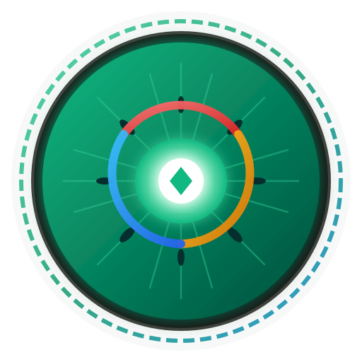
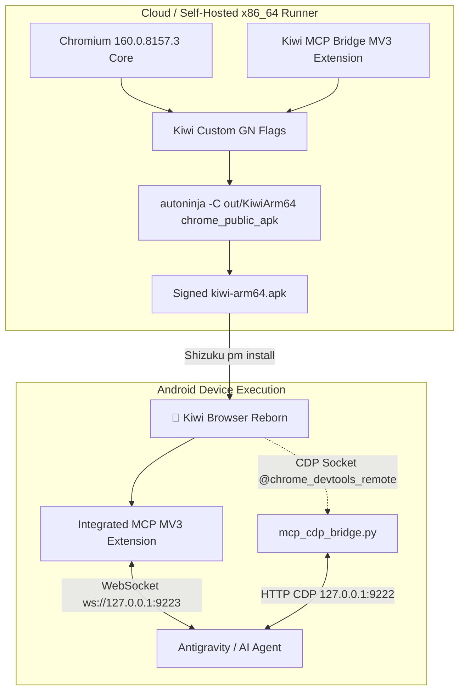

<p align="center">
  
</p>

<h1 align="center">🥝 Kiwi Browser: Reborn</h1>

<p align="center">
  <b>The browser that brought desktop extensions to Android is back &mdash; upgraded, modernized, and supercharged with Native AI Agent Tools.</b>
</p>

<p align="center">
  <a href="https://djsusmith.github.io/kiwi-next/">
    
  </a>
  <a href="https://github.com/djsusmith/kiwi-next/actions">
    
  </a>
  <a href="https://github.com/djsusmith/kiwi-next/blob/main/CHROMIUM_VERSION">
    
  </a>
  <a href="https://github.com/djsusmith/kiwi-next/tree/main/extensions/kiwi_mcp_bridge">
    
  </a>
</p>

---

## 🔥 We Picked Up the Torch

When Kiwi Browser was officially archived in early 2025, mobile power users and developers lost the pioneer that first proved Android could run full desktop extensions.

**We refused to let Kiwi die.**

We restarted the project from the ground up:
1. **Engine Modernization:** Upgraded the stale core all the way to **Chromium 160 Dev (`160.0.8157.3`)** with current Blink, V8 engine optimizations, and hardware acceleration.
2. **AI Era Integration:** Added first-class **Model Context Protocol (MCP)** tool bridge support, giving modern autonomous AI coding assistants (Antigravity, Claude, Cursor) programmatic control to inspect web pages, evaluate scripts, automate testing, and capture high-res viewports.
3. **Open & Reproducible:** Replaced proprietary black-box compile servers with a fully transparent, reproducible **GitHub Actions + `depot_tools`** build system.

---

## ✨ Features at a Glance

### 🚀 Cutting-Edge Chromium 160 Core
Enjoy modern web standards, improved memory management on high-refresh Android flagships, and zero legacy vulnerabilities.

### 🧩 True Desktop Extensions (Manifest V3)
Install extensions directly from developer source directories, `.crx`, or unpacked folders on your mobile device.

### 🤖 Model Context Protocol (MCP) Bridge
Built-in `kiwi_mcp_bridge` turns your phone into an autonomous web testing and scraping environment for AI agents.

| MCP Tool | Capability |
| :--- | :--- |
| `list_tabs` | Query all active/background tabs, URLs, and titles |
| `navigate` | Send tabs to target URLs automatically |
| `eval_js` | Execute client-side JavaScript in page context |
| `capture_screenshot` | Grab pristine PNG viewport captures |

### ⚡ Shizuku / ADB Elevated Deployment
Cleanly deploy, install, launch, and expose DevTools sockets over ADB/Shizuku without requiring root:
```bash
# Install and launch directly on device
bash scripts/deploy_shizuku.sh path/to/kiwi-arm64.apk
```

---

## 🏛️ System Architecture



---

## 📦 Getting the APK

1. **GitHub Releases & Artifacts:** Visit our [Actions Workflow](https://github.com/djsusmith/src.next/actions) to download the latest automated `kiwi-arm64.apk` builds.
2. **Build It Yourself:** Run the reproducible pipeline using your own runner and [`.github/workflows/build_apk.yml`](.github/workflows/build_apk.yml).

---

## 👥 Lead Maintainer & Credits

<div align="center">

### **Ahnaf Hasan Susmith**  
*Lead Architect & Maintainer &bull; Kiwi Next Project*  
📬 [susdj.96@gmail.com](mailto:susdj.96@gmail.com) &bull; 💻 [GitHub Profile](https://github.com/djsusmith)

*Engineered, modernized, and revived in collaboration with **Antigravity** (Google DeepMind).*

</div>

---

## 🤝 Community & Contributing

Kiwi Next is an independent revival project led by **Ahnaf Hasan Susmith**. We welcome code contributions, issue reports, and pull requests!

- 🌐 **Project Webpage:** [https://djsusmith.github.io/kiwi-next/](https://djsusmith.github.io/kiwi-next/)
- 💻 **Source Code:** [https://github.com/djsusmith/kiwi-next](https://github.com/djsusmith/kiwi-next)
- 📦 **Releases:** [https://github.com/djsusmith/kiwi-next/releases](https://github.com/djsusmith/kiwi-next/releases)
- 📜 **License:** [Kiwi Browser & Chromium License](LICENSE)

*Created with passion by Ahnaf Hasan Susmith with Antigravity to keep open-source mobile browser innovation alive.*
